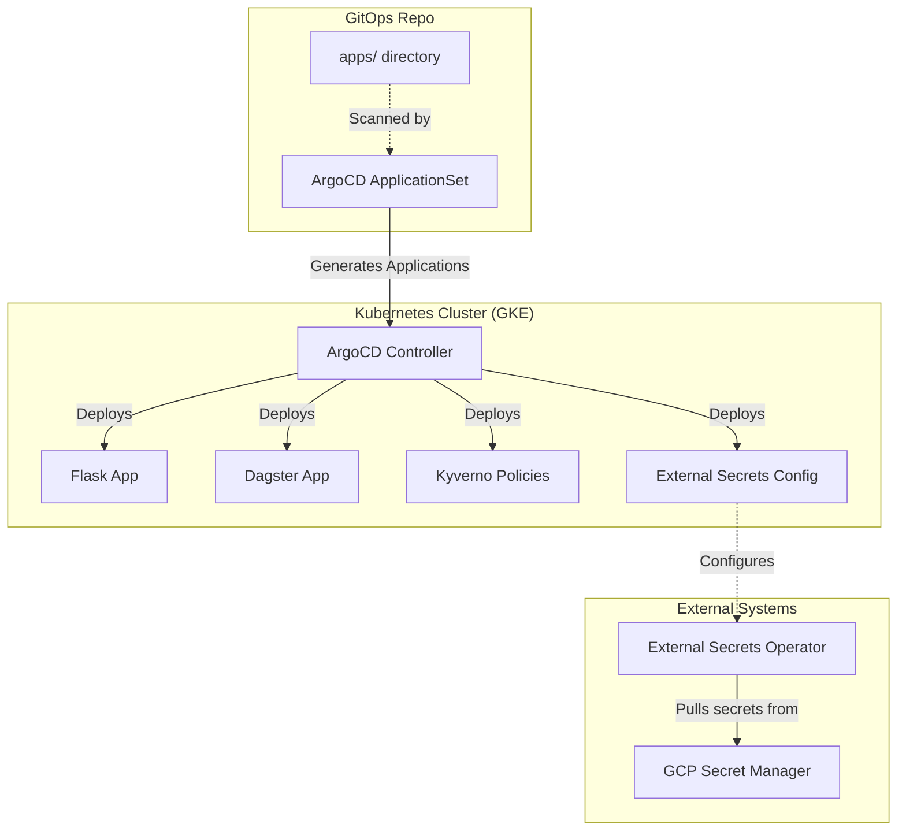

# Retail Data Platform: GitOps Manifests


This repository is the **single source of truth for the Kubernetes cluster state** of the Retail Data Platform. ArgoCD continuously monitors it and reconciles the cluster to match the manifests defined here.

## Related Repositories

This platform uses a multi-repo architecture:

| Repository | Purpose |
|---|---|
| [RetailDataPlatform](https://github.com/benkivuva/RetailDataPlatform) | Application code (Python, dbt, Flask, Dagster) |
| [retail-platform-infrastructure](https://github.com/benkivuva/retail-platform-infrastructure) | Terraform for GCP infrastructure (GKE, Cloud SQL, BigQuery, IAM) and ArgoCD bootstrap |
| **retail-platform-gitops** (this repo) | Kubernetes manifests reconciled by ArgoCD |

## Architecture

This repo uses the **ArgoCD ApplicationSet** pattern. Instead of registering every application with ArgoCD by hand, a single `ApplicationSet` watches the `apps/` directory. Any new folder added there is automatically discovered, deployed, and managed.



> The ArgoCD controller and the External Secrets Operator themselves are installed by Terraform in `retail-platform-infrastructure` (`envs/dev-argocd`). This repo holds only their configuration.

## Repository Structure

```text
.
├── argocd/
│   └── applicationset.yaml    # Core GitOps engine; auto-discovers apps/
└── apps/
    ├── flask/                 # Flask dashboard (Deployments, Services, Secrets)
    ├── dagster/               # Dagster orchestrator (Webserver & Daemon)
    ├── external-secrets/      # Syncs GCP Secret Manager secrets into Kubernetes
    └── policies/              # Kyverno cluster policies (e.g. block root containers)
```

## Deployment Workflow

1. A developer pushes a new application folder to `apps/`.
2. The `ApplicationSet` detects the new folder on its next Git poll.
3. ArgoCD creates an Application and deploys the resources to the cluster.
4. When CI updates a Docker image tag in this repo, ArgoCD detects the diff and performs a rolling update.
5. If someone changes the cluster by hand, ArgoCD detects the drift and (with self-heal enabled) reverts it.

## Adding a New Application

```bash
mkdir apps/my-app
# add deployment.yaml, service.yaml, etc.
git add apps/my-app
git commit -m "feat: add my-app"
git push origin main
```

ArgoCD picks it up automatically; no manual registration is needed.

## Secrets

No secrets are stored in this repo. Secret values live in **GCP Secret Manager** and are synced into the cluster by the External Secrets Operator. Manifests here reference secrets by name only, through `ExternalSecret` resources in `apps/external-secrets/`.

## Policies

Kyverno policies in `apps/policies/` are deployed and enforced through ArgoCD like any other app. For example, the root-container policy rejects pods that try to run as root.

## Verifying the State

```bash
# List all ArgoCD applications and their sync/health status
kubectl get applications -n argocd

# Inspect one application in detail
kubectl describe application <app-name> -n argocd

# Check synced external secrets
kubectl get externalsecrets -A
```

## Troubleshooting

| Symptom | Likely cause |
|---|---|
| Application stuck in `OutOfSync` | Invalid manifest or sync error; check `kubectl describe application` |
| Pod rejected on creation | A Kyverno policy blocked it (e.g. running as root) |
| Secret not appearing | Check the `ExternalSecret` status and the Secret Manager IAM permissions |
| New folder not deployed | Confirm it sits directly under `apps/` and has been pushed to `main` |

## Contributing

1. Branch from `main` and change or add manifests under `apps/`.
2. Validate locally (`kubectl apply --dry-run=client -f apps/<app>/`).
3. Open a pull request and merge after review.
4. ArgoCD reconciles the cluster automatically.